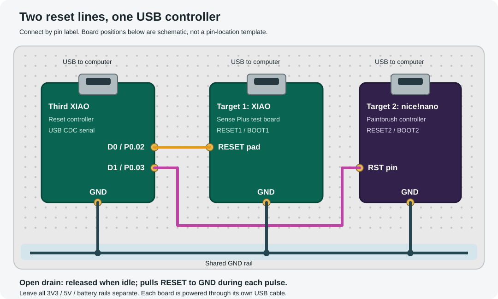

# Reset controller

A third **Seeed Studio XIAO nRF52840 Sense Plus** controls the reset pins of the test XIAO and nice!nano. The same D0/D1 wiring applies to the original XIAO nRF52840 and Sense. Each board keeps its own USB power/data connection.



| Controller connection | Connect to |
| --- | --- |
| D0 / P0.02 | Target 1 XIAO **RESET** pad |
| D1 / P0.03 | Target 2 nice!nano **RST** pin |
| GND | Both targets’ GND pins through a shared breadboard ground rail |

The outputs use open-drain GPIO: they either connect RESET to ground or release it. **Do not connect the boards’ 3V3, 5V, or battery pins together.** Use the target’s RESET pad, not its user-button GPIO. These connections reproduce pressing its reset button. [Seeed pinout](https://wiki.seeedstudio.com/XIAO_BLE/) · [nice!nano reset instructions](https://nicekeyboards.com/docs/nice-nano/getting-started/)

Build from this folder:

```sh
cargo build --release --features firmware --bin kb-resetter
```

Create the UF2 from the kb.wlt repository root:

```sh
cargo xtask uf2 resetter/target/thumbv7em-none-eabihf/release/kb-resetter dist/resetter.uf2 --s140v7
```

The default application address is `0x27000` for a XIAO with S140 v7. Double-press the third XIAO’s own reset button, then copy `dist/resetter.uf2` onto its bootloader drive. If its bootloader uses S140 v6, build with `KB_FLASH_ORIGIN=0x26000` and omit `--s140v7` during UF2 conversion. Firmware that removes SoftDevice needs matching `KB_FLASH_ORIGIN=0x1000` and converter `--nosd`; the resetter does not change a bootloader or SoftDevice itself.

Use Python 3 on macOS/Linux; no additional packages are required:

```sh
python3 resetter/resetter.py ports
python3 resetter/resetter.py --port /dev/cu.usbmodem123 PING STATUS
python3 resetter/resetter.py --port /dev/cu.usbmodem123 RESET1
python3 resetter/resetter.py --port /dev/cu.usbmodem123 BOOT2
python3 resetter/resetter.py --port /dev/cu.usbmodem123 BOOT1 BOOT2
```

`--port` can be omitted when exactly one USB serial device exists. The tool verifies the resetter’s identity before sending an operation and waits for its completion.

The serial protocol is ASCII at 115200 baud, one command per line. `PING` replies `PONG kb-resetter 1`; `STATUS` reports both channels. `RESET1`/`RESET2` pull the selected reset low for 100 ms. `BOOT1`/`BOOT2` issue two 100 ms pulses separated by 200 ms released, matching the double-reset bootloader entry. Operations reply `ACK <command>` immediately and `DONE <command>` when the pin is released. Both channels run independently; an overlapping operation on the same channel receives `ERR BUSY <command>`. `DONE` confirms the reset sequence, not that the target booted successfully.

Test without hardware from the repository root:

```sh
cargo test --manifest-path resetter/Cargo.toml --target aarch64-apple-darwin
python3 -m unittest discover -s resetter/tests -p 'test_*.py'
```

Use your host Rust target instead of `aarch64-apple-darwin` on another machine. Tests cover command framing, independent channels, pulse timing, clock wrap, and the serial client through a simulated terminal. Hardware operation remains unverified.
